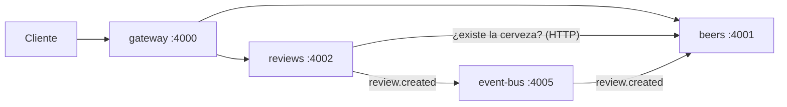

# Lúpulos · microservicios de práctica

Un sistema chico con el tema de Lúpulos para aprender microservicios haciéndolos. No es parte de la app en producción.

```bash
npm install
npm start        # levanta los 4 servicios
npm run demo     # en otra terminal: recorre el sistema por el gateway
```

## Qué hay



| Servicio | Puerto | Es dueño de | Hace |
|---|---|---|---|
| `gateway` | 4000 | nada | Única puerta de entrada. Reparte cada pedido al servicio que corresponde y junta la salud de todos. |
| `beers` | 4001 | las cervezas | Catálogo. Escucha `review.created` para recalcular el promedio. |
| `reviews` | 4002 | las reseñas | Guarda reseñas. Pregunta a `beers` si la cerveza existe y publica `review.created`. |
| `event-bus` | 4005 | las suscripciones | Recibe eventos y se los entrega a quien se suscribió. |

## Cómo lo construí, paso a paso

### 1. Una base común para todos los servicios

`shared/service.mjs` crea un Express con lo que todos necesitan: JSON, un log por pedido, `/health` y un manejador de errores. Cada servicio solo agrega sus rutas. Así un servicio nuevo parte en tres líneas:

```js
const { app, listen } = createService("beers");
app.get("/beers", ...);
listen(4001);
```

### 2. Cada servicio es dueño de sus datos

`beers` guarda las cervezas y `reviews` las reseñas. **Ninguno lee los datos del otro**: si `reviews` necesita saber algo de una cerveza, se lo pregunta a `beers` por HTTP. Esta es la regla más importante de los microservicios: si dos servicios comparten tablas, en realidad son uno solo, partido en dos.

Aquí los datos viven en memoria para que sea simple. En un sistema real, cada servicio tendría su propia base (o al menos su propia colección).

### 3. Comunicación síncrona: preguntar y esperar

Antes de guardar una reseña, `reviews` le pregunta a `beers` si la cerveza existe y espera la respuesta:

```js
res = await fetch(`${SERVICES.beers}/beers/${beerId}`, { signal: AbortSignal.timeout(2000) });
```

El `timeout` es clave: si `beers` está lento, `reviews` no se queda colgado esperando para siempre.

### 4. Comunicación asíncrona: avisar sin esperar

Cuando se guarda una reseña, `reviews` **no** le dice a `beers` "actualiza el promedio". Publica un hecho, `review.created`, y sigue. El bus se lo entrega a quien esté suscrito (`beers`), que recalcula el promedio por su cuenta.

Ventajas:
- `reviews` no necesita saber quién usa sus eventos. Mañana puede suscribirse un servicio de notificaciones sin tocar `reviews`.
- Si `beers` está caído, la reseña igual se guarda.

### 5. Consistencia eventual

Por lo anterior, el promedio de la cerveza **se actualiza un instante después** de crear la reseña, no en el mismo momento. Por eso la demo espera 300 ms antes de leerlo. En microservicios esto es normal: se acepta un pequeño desfase a cambio de que los servicios no dependan tanto entre sí.

### 6. Un gateway como única puerta

El cliente solo conoce `localhost:4000`. El gateway traduce `/api/beers` → servicio `beers`, `/api/reviews` → servicio `reviews`. Si mañana `beers` se divide en dos o cambia de servidor, el cliente no se entera.

### 7. Aislamiento de fallas

Probado apagando solo `beers`:

| Pedido | Resultado |
|---|---|
| `GET /api/health` | 503, y dice cuál cayó: `"beers": "caído"` |
| `GET /api/reviews` | **200**: las reseñas se siguen leyendo |
| `GET /api/beers` | 503 con mensaje claro |
| `POST /api/reviews` | 503: "El servicio de cervezas no responde; intenta en un momento" |

Un servicio caído no tumba a los demás. En un monolito, el mismo error se habría llevado toda la app.

## Lo que este ejemplo simplifica

Para que se entienda, faltan cosas que un sistema real sí tiene:

- **Bus de eventos real** (RabbitMQ, Kafka, SQS): guarda los eventos si el suscriptor está caído y los reintenta. El de aquí los pierde.
- **Bases de datos propias** por servicio, en vez de memoria.
- **Descubrimiento de servicios y configuración**: aquí las direcciones están fijas en `shared/service.mjs`.
- **Contenedores** (Docker) y un orquestador (Kubernetes, ECS) para levantar, escalar y reiniciar servicios.
- **Trazas distribuidas**: un id que sigue un pedido por todos los servicios, para depurar.

## ¿Y Lúpulos debería ser así?

Hoy no. Con un equipo chico y pocos usuarios, el costo de operar varios servicios (deploys, monitoreo, red, datos repartidos) supera lo que se gana. Lúpulos está mejor como **monolito modular**: un solo deploy, pero ordenado por dominios (`features/beers`, `features/lugares`…), con límites claros. Si un módulo un día necesita escalar aparte, por ejemplo el chat en tiempo real, se separa entonces.

## Ejercicios para practicar

1. **Agrega un servicio `notifications`** (puerto 4003) que se suscriba a `review.created` y haga `console.log("Nueva reseña para la cerveza X")`. No toques `reviews`: esa es la gracia de los eventos.
2. **Haz que el bus reintente**: si la entrega a un suscriptor falla, reintenta 3 veces con espera creciente (500 ms, 1 s, 2 s).
3. **Agrega un id de correlación**: el gateway genera un `x-request-id`, cada servicio lo reenvía y lo muestra en su log. Sigue un pedido de punta a punta.
4. **Persiste los datos**: que `reviews` guarde en un archivo JSON propio y los recupere al reiniciar.
5. **Pon un caché en el gateway** para `GET /api/beers`, de 10 segundos. Apaga `beers` y observa que la lista se sigue viendo un rato.
